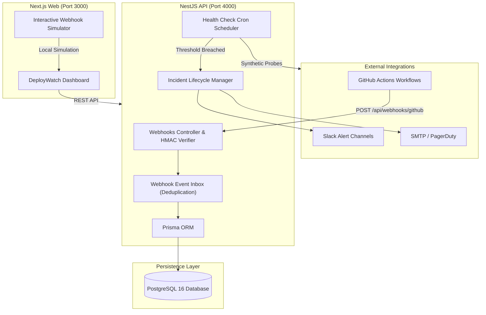

# DeployWatch — Production CI/CD & Deployment Monitoring Platform

> **Portfolio Project Specification · Production-Oriented · Version 1.0**  
> Designed for Junior Full-Stack Developer portfolios focusing on resilient architecture, real-world DevOps integrations, webhook ingestion pipelines, and observability.

---

## 🚀 Overview

**DeployWatch** is a centralized CI/CD observability and health monitoring platform designed to aggregate build pipelines, production deployments, and microservice uptime across multiple repositories into a unified command center.

Instead of mock charts, DeployWatch implements real-world infrastructure patterns:
- **GitHub Actions Ingestion Engine**: Receives and verifies incoming `workflow_run` webhooks using HMAC-SHA256 signatures, deduplicating events with idempotent inbox tables.
- **Automated Health Checking & Flapping Prevention**: Configurable synthetic probes with failure/recovery thresholds (e.g., 3 consecutive failures before alerting) to eliminate transient alert flapping.
- **Incident Lifecycle Management**: Auto-opens incidents on sustained downtime, dispatches alert webhooks (Slack/Email), and tracks full audit logs and post-mortem resolutions.
- **Modern High-Performance UI**: Dark-mode glassmorphic dashboard built with Next.js 14 App Router and Vanilla CSS design tokens. Includes a built-in **Webhook Simulator** so reviewers can trigger real-time pipeline updates instantly.

---

## 🏗️ Architecture



---

## 🛠️ Technology Stack

| Layer | Technologies |
|---|---|
| **Frontend** | Next.js 14 (App Router), React 18, Vanilla CSS Design System, Lucide Icons |
| **Backend** | NestJS 10, TypeScript 5, Passport JWT, Swagger/OpenAPI, `@nestjs/schedule` |
| **Database & ORM**| PostgreSQL 16, Prisma ORM 6 |
| **Security** | HMAC-SHA256 GitHub Webhook validation, Argon2/Bcrypt password hashing, Role-Based Access Control (`OWNER`, `ADMIN`, `MEMBER`, `VIEWER`) |
| **DevOps & Containers** | Docker, Docker Compose, Multi-stage production container builds |

---

## ⚡ Quick Start

### 1. Prerequisites
- **Node.js**: `>= 20.0.0`
- **Docker & Docker Compose** (for PostgreSQL)

### 2. Environment Setup
```bash
# Clone the repository
git clone https://github.com/your-username/deploywatch.git
cd deploywatch

# Copy environment variables
cp .env.example .env
```

### 3. Spin up PostgreSQL
```bash
docker-compose up -d postgres
```

### 4. Database Migration & Seed
```bash
# Run Prisma migrations
npm run db:migrate -w apps/api

# Populate database with realistic demo data (users, runs, services, incidents)
npm run db:seed -w apps/api
```

**Seed Credentials**:
- **Admin**: `admin@deploywatch.dev` / `password123`
- **Developer**: `sarah@deploywatch.dev` / `password123`

### 5. Start Development Servers
```bash
# Run both Backend API and Web Frontend concurrently
npm run dev
```

- **Frontend Dashboard**: [http://localhost:3000](http://localhost:3000)
- **Backend API & Swagger Docs**: [http://localhost:4000/api/docs](http://localhost:4000/api/docs)

---

## 💡 Key Engineering Features

### 1. GitHub Webhook Security & Idempotency
- Validates the `X-Hub-Signature-256` header against the repository's configured secret using constant-time string comparison (`crypto.timingSafeEqual`) to prevent timing attacks.
- Prevents duplicated event processing via a database unique constraint on `(provider, delivery_id)`.

### 2. Anti-Flap Synthetic Probes
- Rather than alerting on a single 500 error or network blip, the scheduler requires `failure_threshold` consecutive failures before opening an incident.
- When the service recovers, it requires `success_threshold` consecutive 200 OK responses before auto-resolving the incident.

### 3. Interactive Webhook Simulator
- In the web UI, click **"Simulate GitHub Webhook"** on the top right to dispatch custom pipeline payloads and verify live UI reactivity in real-time.

---

## 📂 Project Directory Structure

```
deploywatch/
├── apps/
│   ├── api/                   # NestJS Backend API
│   │   ├── prisma/            # Schema definition & rich seed script
│   │   └── src/
│   │       ├── auth/          # JWT Auth & Organization RBAC
│   │       ├── webhooks/      # GitHub webhook receiver & HMAC verification
│   │       ├── health-checks/ # Synthetic scheduler & flapping prevention
│   │       ├── incidents/     # Incident lifecycle management
│   │       ├── deployments/   # Deployment records & velocity metrics
│   │       ├── projects/      # Multi-tenant project administration
│   │       └── common/        # Prisma service & shared interceptors
│   └── web/                   # Next.js 14 Frontend Web Application
│       └── src/
│           └── app/           # App Router pages, design system & dashboard
├── docker-compose.yml         # Local development database container
└── package.json               # Monorepo workspace configuration
```

---

## 👤 Author & Portfolio
- **Author**: Foam — Junior Full-Stack Developer
- **GitHub**: [@Foam-01](https://github.com/Foam-01)
- **Portfolio**: [portfoliof-01.netlify.app](https://portfoliof-01.netlify.app)

---

## 📄 License
MIT License © 2026 Foam. Built for Junior Full-Stack Developer Portfolio Showcase.

