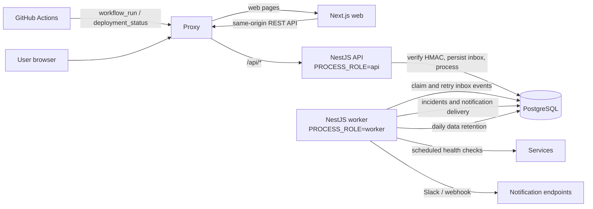
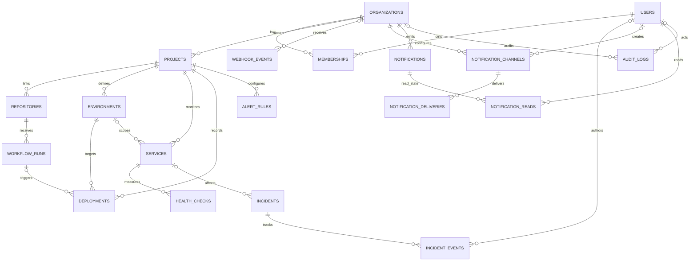

# Architecture and data model

## Runtime architecture

The API and background worker are separate processes built from the same NestJS
application. `PROCESS_ROLE=api` serves HTTP requests; `PROCESS_ROLE=worker` runs
schedulers. The development Compose stack runs PostgreSQL, migrations, API, worker,
and Next.js. The production Compose stack adds Nginx as a same-origin reverse proxy.

In local development the browser can call the API directly on port 4000. In
production Nginx routes `/api/` to the API and all other paths to the web service.
The worker does not expose an HTTP port. Scheduled work is disabled in API-only
processes to avoid running the same schedulers in both services.

## Webhook processing

1. The GitHub webhook controller verifies `X-Hub-Signature-256` against the raw
   request body and the repository's secret.
2. The inbox stores the delivery ID under a unique `(provider, delivery_id)` key.
   Repeated deliveries are acknowledged without applying the event twice.
3. The request path attempts immediate processing. Failed processing is retained
   with attempt state and a retry time.
4. The worker claims due rows using an atomic `SKIP LOCKED` query, applies the event,
   and records success or schedules a backoff retry.
5. The retention job redacts payload JSON only for old, terminal events. It retains
   inbox rows and their unique delivery IDs so old deliveries remain deduplicated.

## Health checks and incidents

The worker polls enabled services on their configured intervals. Probe results are
stored in `health_checks`; an enabled project-level `SERVICE_DOWN` alert rule overrides
each service's failure threshold, otherwise its service-specific value applies.
Consecutive success thresholds remain service-specific. These thresholds control
`services.current_status` and incident creation. A recovery changes the service
status and adds timeline context, but the incident stays open until an operator
resolves it. Old health-check rows are removed by the daily retention job.

## Delivery analytics

The dashboard returns daily counts of successful and failed workflow runs and
deployments for the selected 7- or 30-day UTC window. Aggregates are scoped by the
authenticated organization and queried from indexed creation-time ranges; missing
dates are filled with zeroes for a continuous chart.

## Entity relationship diagram

The diagram shows the persisted domain relationships. `?` denotes an optional
foreign key; `*` denotes a join/association entity.

`webhook_events.repository_id` is intentionally not a foreign-key relation: keeping
the inbox row lets the unique provider/delivery ID continue to prevent duplicate
processing even after a repository is unlinked. Organization and user references in
audit records, and creator references on notification channels, are optional so
historical records can survive account removal.
