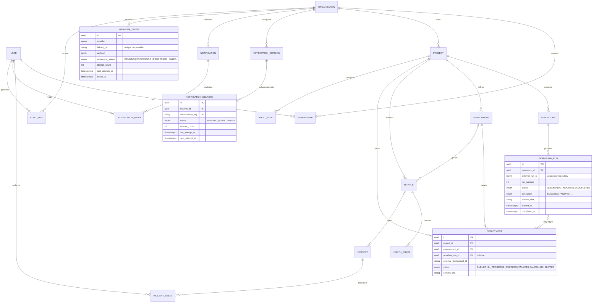

# Database design

PostgreSQL 16 managed through Prisma (`apps/api/prisma/schema.prisma`). Every
schema change ships as a migration in `apps/api/prisma/migrations/`; CI applies
them to an empty database on every run (spec critical case #10).

All timestamps are `TIMESTAMPTZ` stored in UTC and formatted in the browser.

## Entity relationships

Workflow runs and deployments are separate entities on purpose: a run can pass
while the deployment it triggers fails, and one run can deploy to several
environments (spec §5.4).

## Integrity rules (spec §7.2)

| Rule | How it is enforced |
|---|---|
| Unique user email, case-insensitive | `users.email` unique; the API lower-cases before every read and write |
| One membership per user per organization | `@@unique([organizationId, userId])` |
| A repository is linked once | `@@unique([provider, externalRepoId])` |
| No duplicate workflow runs | `@@unique([repositoryId, externalRunId])` |
| No duplicate webhook processing | `@@unique([provider, deliveryId])` — the insert itself is the idempotency check, so concurrent redeliveries cannot both be stored |
| No duplicate notifications | `notification_deliveries.idempotency_key` unique (`<channelId>:<eventKey>`); `notifications` unique on `(organization_id, event_key)` |
| Time-range queries | indexes on `health_checks(service_id, checked_at DESC)` and `workflow_runs(repository_id, created_at DESC)`, `(status, created_at)`, `(conclusion, created_at)` |
| Organization scoping | every query filters through `organization_id` (directly or via project); integration tests `access-control.spec.ts` and `organization-admin.spec.ts` prove cross-organization reads and writes return 404 |
| Multi-step writes | incident transitions, membership changes and project creation run in a transaction together with their audit-log row |
| History survives archive | archiving only sets `projects.status`; environments with deployment history cannot be deleted |

Deviation from the spec: the list views sort by `created_at`, so the index is on
`workflow_runs.created_at` rather than `started_at` (`started_at` is null until a
run starts).

## Secrets at rest

`repositories.webhook_secret`, `repositories.integration_token` and
`notification_channels.config_encrypted` hold AES-256-GCM ciphertext
(`enc:v1:<iv>:<tag>:<ciphertext>`) keyed by `ENCRYPTION_KEY`. API responses never
include them; channel destinations are shown masked. `npm run secrets:encrypt
-w apps/api` migrates rows written before encryption was introduced.

## Retention (spec §7.4)

A daily job (`DataRetentionService`, 03:15, worker process only) deletes:

| Data | Default | Variable |
|---|---|---|
| Raw health-check results | 30 days | `HEALTH_CHECK_RETENTION_DAYS` |
| Processed webhook payloads | 90 days | `WEBHOOK_EVENT_RETENTION_DAYS` |

Audit logs, incidents and run/deployment history are kept.

## Backup and restore

`npm run db:backup` writes a `pg_dump --format=custom` file to `backups/` from the
Compose `postgres` service; `npm run db:restore -- --file <dump> --confirm`
validates the archive with `pg_restore --list` before restoring. See
`docs/operations.md` for the tested procedure.
